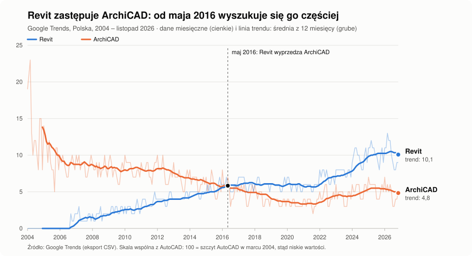
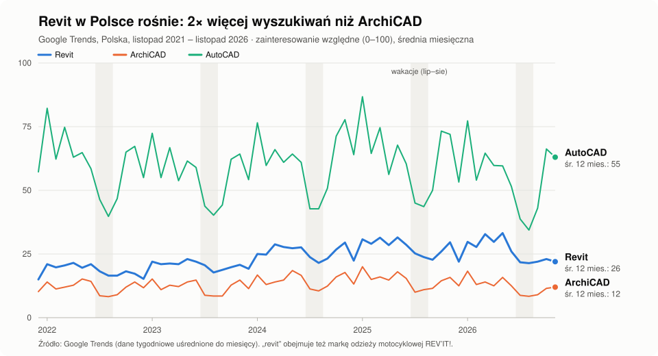

**Polskie biblioteki i standardy do Revita** — rodziny, materiały, wzory wypełnień i style wymiarowania gotowe do pobrania.

[pafkoroki.github.io/PAAS](https://pafkoroki.github.io/PAAS/)

## Dlaczego Revit

Revit w Polsce zastępuje ArchiCAD. W 2004 roku prawie nikt go nie szukał. W 2015 roku zrównał się z ArchiCAD, a od maja 2016 roku, licząc średnią z 12 miesięcy, wyszukuje się go częściej i ta przewaga ciągle rośnie. Dziś Revit ma ok. 2× więcej wyszukiwań niż ArchiCAD. Polskich bibliotek i standardów do Revita jest za to wciąż mało i to jest luka, którą wypełnia PAAS.

<picture>
  <source media="(prefers-color-scheme: dark)" srcset="docs/trends/trends-pl-2004-dark.svg">
  
</picture>

| Rok | Revit | ArchiCAD | AutoCAD | Revit / ArchiCAD |
|---|---|---|---|---|
| 2004 | 0,0 | 13,8 | 80 | – |
| 2008 | 1,8 | 8,2 | 52 | 0,22× |
| 2012 | 4,0 | 7,7 | 53 | 0,52× |
| 2014 | 4,8 | 6,4 | 50 | 0,75× |
| 2015 | 5,5 | 5,7 | 46 | 0,97× |
| 2016 | 5,8 | 5,5 | 40 | 1,06× |
| 2018 | 6,1 | 4,2 | 28 | 1,43× |
| 2020 | 5,8 | 3,3 | 22 | 1,75× |
| 2022 | 7,1 | 4,4 | 23 | 1,60× |
| 2024 | 9,7 | 5,2 | 24 | 1,84× |
| 2025 | 10,2 | 5,4 | 24 | 1,89× |
| 2026* | 10,2 | 4,8 | 21 | 2,11× |

Google Trends, Polska, średnia roczna z danych miesięcznych. Wszystkie trzy programy są w jednej skali, w której 100 to szczyt AutoCAD w marcu 2004, dlatego wartości Revit i ArchiCAD są niskie. AutoCAD spada z 80 do ok. 21, czyli przez 20 lat stracił ok. ¾ zainteresowania. \*2026: styczeń–listopad. Liczby dla hasła „revit” obejmują też markę odzieży motocyklowej REV’IT!, więc rzeczywiste zainteresowanie programem jest trochę niższe.

### Ostatnie 5 lat z bliska

<picture>
  <source media="(prefers-color-scheme: dark)" srcset="docs/trends/trends-pl-dark.svg">
  
</picture>

Dane tygodniowe uśrednione do miesięcy, skala 0–100 liczona tylko dla ostatnich 5 lat, więc wartości są inne niż w wykresie od 2004 roku.

**Co z tego wynika dla projektu**

- **Najwięcej wyszukiwań jest w roku akademickim:** szczyty w styczniu, w marcu–czerwcu i w październiku–grudniu, a dołki w lipcu–sierpniu i w święta. Nowe elementy i promocję najlepiej planować przed październikiem i przed styczniem.
- **Wśród rosnących zapytań dominują numery wersji** („revit 2025”, „revit 2024”). Warto podawać przy plikach wersję Revita, w której zostały zapisane.

Dane źródłowe: [docs/trends/google-trends-pl-2004-2026.csv](docs/trends/google-trends-pl-2004-2026.csv) (miesięczne) i [docs/trends/google-trends-pl-2021-2026.csv](docs/trends/google-trends-pl-2021-2026.csv) (tygodniowe). Oba wykresy generuje skrypt [docs/trends/make_chart.py](docs/trends/make_chart.py).
