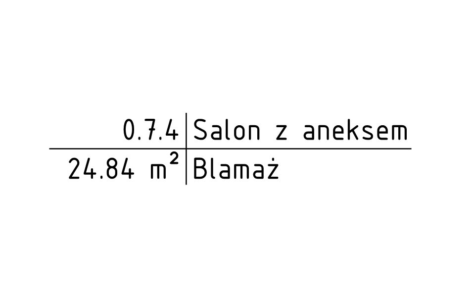
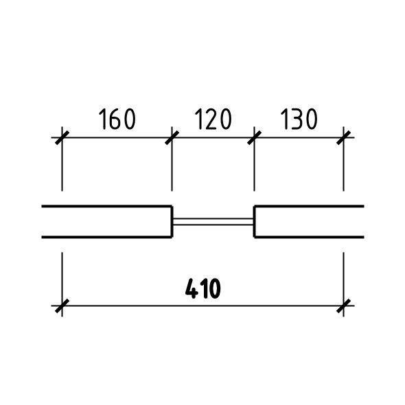
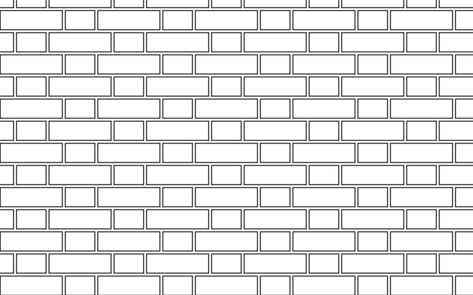
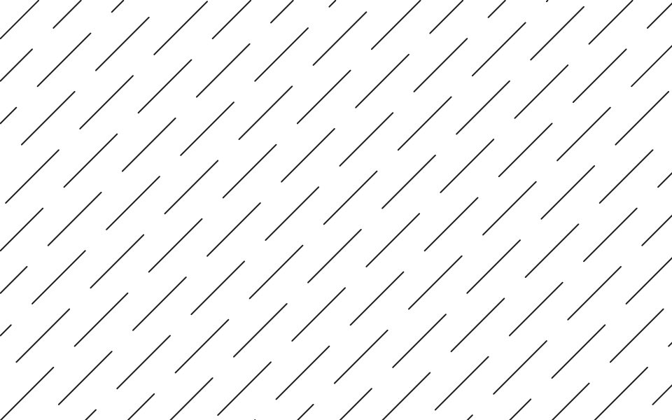

<div align="center">


### Polish Architectural Asset System

Polskie biblioteki i standardy do Revita: rodziny, materiały, wzory wypełnień i style wymiarowania,<br>
przygotowane według polskich norm rysunku budowlanego i gotowe do pobrania.

**[Otwórz katalog →](https://pafkoroki.github.io/PAAS/)**

</div>

<br>

<table>
  <tr>
    <td width="25%"></td>
    <td width="25%"></td>
    <td width="25%"></td>
    <td width="25%"></td>
  </tr>
  <tr>
    <td align="center"><sub>Oznaczenie pomieszczenia</sub></td>
    <td align="center"><sub>Style wymiarowania</sub></td>
    <td align="center"><sub>Wiązanie flamandzkie, cegła DF</sub></td>
    <td align="center"><sub>Wypełnienie: beton</sub></td>
  </tr>
</table>

## Zawartość

| Dział | Co zawiera | Pliki |
|---|---|---|
| **Opisz** | Etykiety drzwi, okien i przejść, oznaczenie pomieszczenia, rzędna punktu, nachylenie w % i w °, zestaw stylów wymiarowania, fonty ISOCPEUR i Pismo Techniczne | `.rfa` `.rvt` `.ttf` |
| **Materiały** | 15 materiałów (betony C8/10–C25/30, żelbet, jastrych, beton komórkowy, izolacje, grunty, drewno, szkło) z parametrami cieplnymi λ, ρ, c. Każdy plik otwiera się widokiem przeciętej próbki 1 × 1 × 1 m | `.rvt` |
| **Wzory** | 9 wypełnień kreślarskich (beton, żelbet, gruzobeton, ziemia, podsypki, styropian, wełna, drewno) i 12 wiązań cegły DF 210 × 100 × 65 mm z fugą 10 mm | `.pat` |
| **Architektura, Konstrukcja, Systemy** | Rodziny ścian, stropów, okien, drzwi i elementów konstrukcji | w przygotowaniu |

## Standardy

- **Wymiarowanie** według PN-B-01029 i PN-ISO 129: ukośna kreska jako znacznik wymiarów liniowych, zewnętrzne cyfry 4,0 mm, wewnętrzne 3,5 mm pogrubione, odstęp ciągów 8 mm.
- **Parametry cieplne materiałów** według PN-EN ISO 10456 (grunty według PN-EN ISO 13370, izolacje według deklaracji producenta).
- **Pismo** ISOCPEUR zgodne z PN-EN ISO 3098 we wszystkich opisach i wymiarach.
- **Nazewnictwo plików** według schematu `PAAS_<Typ>_<Opis>` opartego na BS 8541-1. Elementy w Revicie mają przedrostek `_PAAS_`, dzięki czemu są zawsze na początku list i nie nadpisują typów w projekcie.

## Jak wczytać

| Plik | W Revicie |
|---|---|
| Rodzina `.rfa` | **Wstaw → Wczytaj rodzinę** |
| Materiały i style wymiarowania `.rvt` | Otwórz plik obok projektu, potem **Zarządzaj → Przenieś standardy projektu** i zaznacz *Materiały* albo *Style wymiarowania* |
| Wzór wypełnienia `.pat` | **Zarządzaj → Dodatkowe ustawienia → Wzory wypełnień**, wybierz *Kreślarskie* albo *Modelowe*, potem **Nowy → Niestandardowy → Importuj** |
| Font `.ttf` | Zainstaluj w systemie i uruchom Revit ponownie |

## Dlaczego Revit

Revit w Polsce zastępuje ArchiCAD. W 2015 roku obu programów szukano tak samo często, a od maja 2016 roku Revita szuka się częściej i ta przewaga stale rośnie. Dziś Revit ma około dwa razy więcej wyszukiwań. Polskich bibliotek i standardów do Revita jest za to wciąż niewiele.

<picture>
  <source media="(prefers-color-scheme: dark)" srcset="docs/trends/trends-pl-2004-dark.svg">
  
</picture>

<sub>Google Trends, Polska. Skala wspólna z AutoCAD: 100 to szczyt AutoCAD w marcu 2004, stąd niskie wartości. Hasło „revit” obejmuje też markę odzieży motocyklowej REV’IT!. Dane: [google-trends-pl-2004-2026.csv](docs/trends/google-trends-pl-2004-2026.csv) · wykres: [make_chart.py](docs/trends/make_chart.py)</sub>

## Rozwój

Strona to aplikacja React + Vite publikowana na GitHub Pages. Katalog buduje się sam z folderów w `public/catalog/`: każdy element to folder z plikiem `meta.json`, miniaturą i plikami do pobrania. Zasady dodawania elementów opisuje [KATALOG.md](KATALOG.md).

```bash
npm install
npm run dev      # podgląd lokalny
npm run deploy   # build i publikacja na GitHub Pages
```

## Uwagi

- Wartości λ, ρ i c w materiałach to wartości obliczeniowe do analiz w Revicie. Do obliczeń projektowych, np. świadectw energetycznych, sprawdź je z kartą produktu.
- Font ISOCPEUR należy do Autodesk Inc. i jest instalowany razem z AutoCAD i Revitem.
